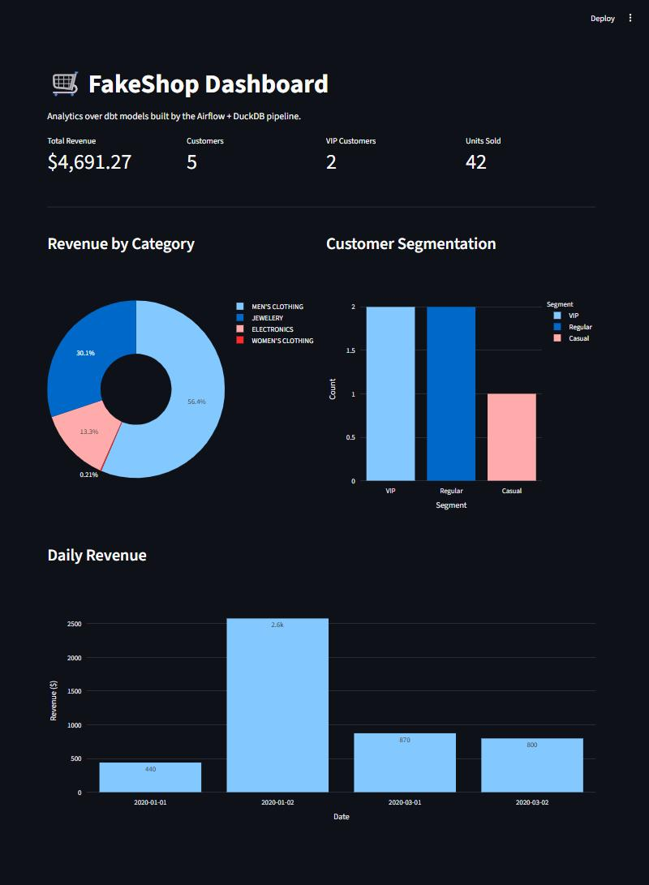
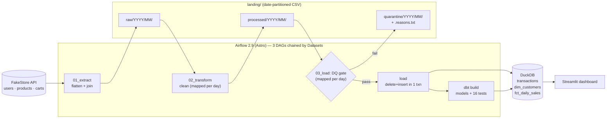

# FakeShop ELT Pipeline — Airflow · DuckDB · dbt

Batch ELT pipeline that pulls e-commerce data from the public
[FakeStore API](https://fakestoreapi.com), lands it as date-partitioned files,
gates every partition through a data-quality contract, loads it idempotently
into a DuckDB warehouse and builds tested dbt marts for a Streamlit dashboard.

**Problem it solves:** raw API data arrives as nested JSON (carts → products,
users) with no guarantees. The pipeline turns it into a typed, tested,
re-runnable warehouse — and a single bad day of data is quarantined instead of
breaking every downstream report.



---

## Architecture



**Flow**

1. **Extract** (`01_fakeshop_extract`, daily) — fetches users, products and carts
   with retry/backoff, denormalises carts into one row per line item and writes
   one raw CSV per cart date.
2. **Transform** (`02_fakeshop_transform`, triggered by the raw Dataset) — one
   mapped task per partition: drop rows missing IDs, enforce types, add
   `sale_tier`, standardise text, stamp `updated_at` (UTC).
3. **Load** (`03_fakeshop_load_duckdb`, triggered by the processed Dataset)
   - *Map:* validate each partition against the contract. Failing files move to
     `landing/quarantine/` with the reasons; the task is **skipped**, not failed.
   - *Reduce:* load passing partitions sequentially (DuckDB has one writer),
     each as delete + insert inside **one transaction**.
   - *dbt build:* rebuilds the marts and runs the dbt data tests.

## Tech stack

| Layer | Tool | Why this choice |
|---|---|---|
| Orchestration | Apache Airflow 2.9 via Astro CLI | Dataset-driven DAG chaining and dynamic task mapping (one task per partition); Astro gives a one-command local Airflow in Docker |
| Processing | Python, pandas | Small daily partitions fit in memory; transforms are pure functions that are easy to unit-test |
| Warehouse | DuckDB | Embedded columnar OLAP engine: SQL + transactions with zero infrastructure, reads CSV natively |
| Modelling | dbt (dbt-duckdb) | Versioned SQL models with built-in data tests and lineage |
| Data quality | custom contract (`include/tasks/quality`) + dbt tests | Row-level checks *before* load (quarantine), aggregate checks *after* load (dbt) |
| Dashboard | Streamlit + Plotly | Python-only, reads DuckDB in read-only mode |
| Quality tooling | pytest, ruff, GitHub Actions | Unit, end-to-end and DAG-integrity tests on every push |

## Quickstart

**Option A — local, no Docker (Python 3.10+):**

```bash
python -m venv .venv && source .venv/bin/activate   # Windows: .venv\Scripts\activate
pip install -r requirements-dev.txt
python scripts/run_local.py --offline               # drop --offline to call the live API
streamlit run dashboard.py
```

`run_local.py` executes the same task functions as the DAGs
(extract → transform → DQ → load → `dbt build`) and prints a JSON summary.
`--offline` uses bundled API fixtures in `tests/fixtures/fakestore/`.

**Option B — full Airflow (Docker + [Astro CLI](https://www.astronomer.io/docs/astro/cli/install-cli)):**

```bash
astro dev start          # Airflow UI on http://localhost:8080 (admin / admin)
```

Unpause the three `fakeshop` DAGs and trigger `01_fakeshop_extract`; the other
two run automatically via Datasets. `landing/` and `warehouse/` are mounted
into the containers, so `streamlit run dashboard.py` on the host reads the
same warehouse.

Optional configuration: see [`.env.example`](.env.example) (`LANDING_DIR`, `DUCKDB_PATH`).

## Data-quality contract

Enforced per partition before loading ([`checks.py`](include/tasks/quality/checks.py)):

| Rule | Why |
|---|---|
| `transaction_id` not null and unique | primary key of the raw table |
| `product_id` not null | joins to products |
| `quantity > 0`, `unit_price > 0` | an unknown product is priced 0 by the extractor → caught here |
| `total_amount ≥ 0` and `= unit_price × quantity` (±0.01) | reconciliation |

After loading, dbt runs 16 tests: `unique`/`not_null`/`accepted_values` on the
source and marts, a unique-grain test on `fct_daily_sales`, and a test that
revenue in the raw table equals revenue in **both** marts.

## Design decisions & trade-offs

- **Quarantine + skip instead of fail.** One corrupt day should not block the
  healthy ones. The load task uses `trigger_rule="none_failed"` so skipped
  (quarantined) partitions don't stop it. Trade-off: a skipped task is quieter
  than a failed one, so the quarantine is logged at `ERROR` with the reasons.
- **Partition-level idempotency.** Each load is `DELETE WHERE date = ?` +
  `INSERT` in one transaction, so re-runs replace a day and a failed load
  rolls back. A guard rejects files containing rows from another date.
- **Explicit casts, all-VARCHAR reads.** The loader does not trust DuckDB's
  CSV type sniffing; the table schema is the contract.
- **Sequential loads.** DuckDB allows a single writer process, so validation
  is parallel but loading is not.
- **dbt in its own virtualenv** inside the Airflow image to avoid dependency
  conflicts; DuckDB is pinned to the same version everywhere because database
  files are not forward-compatible.
- **Airflow-free core.** All logic lives in `include/` and is importable without
  Airflow; DAGs are thin wrappers. This is what makes the 37 unit/e2e tests run
  in seconds on any OS.

## Testing & CI

| Suite | What | Where it runs |
|---|---|---|
| `tests/unit` (37 tests) | transforms, DQ rules, loader idempotency/rollback, extractor error handling, offline end-to-end run incl. a quarantine scenario | local, CI |
| `tests/dags` (14 tests) | all 3 DAGs import, expected IDs, retries, DQ trigger rule, dbt after load, Dataset chaining | Astro (`astro dev pytest`), CI with Airflow 2.9.1 |
| dbt (2 models, 16 tests) | see data-quality section | `dbt build`, CI |

CI ([`.github/workflows/ci.yml`](.github/workflows/ci.yml)): ruff lint + format
check, unit tests with coverage, offline end-to-end pipeline incl. `dbt build`,
and DAG integrity on Airflow 2.9.1 / Python 3.11.

```bash
pytest --cov                     # unit + e2e (DAG tests skip without Airflow)
astro dev pytest                 # everything, inside the Airflow image
ruff check . && ruff format --check .
```

## Results

All numbers below were measured on this repo; commands to reproduce are given.

**Correctness / quality**

| Metric | Value | How measured |
|---|---|---|
| Unit + e2e tests | 37 passed | `pytest` |
| DAG integrity tests | 14 passed (Airflow 2.9.1) | `astro dev pytest` / CI `dag-integrity` job |
| dbt | 2 models, 16 data tests, 18/18 PASS | `dbt build` |
| Line coverage of `include/` | 90 % | `pytest --cov` |
| Duplicate rows after re-loading every partition | 0 (at 10k, 100k, 1M rows) | `scripts/benchmark.py` |
| Bad partition in an Airflow run | quarantined + skipped; other 4 days loaded, dbt 18/18 PASS | `airflow dags test 03_fakeshop_load_duckdb` with an injected negative-quantity day |

**Throughput on synthetic data** (`python scripts/benchmark.py --dbt`;
single run, 30 daily partitions, Windows laptop, 12 logical CPUs, Python 3.10,
pandas 2.2.1, DuckDB 1.5.2; raw results in [`docs/benchmark_results.json`](docs/benchmark_results.json)):

| Rows | Transform | DQ checks | Load (DuckDB) | Re-load all (idempotent) | `dbt build` |
|---:|---:|---:|---:|---:|---:|
| 10,000 | 0.9 s | 0.7 s | 5.2 s | 5.4 s | 29.9 s |
| 100,000 | 2.7 s | 0.9 s | 10.0 s | 9.5 s | 18.0 s |
| 1,000,000 | 18.2 s (≈55k rows/s) | 4.9 s (≈206k rows/s) | 27.8 s (≈36k rows/s) | 25.9 s | 18.7 s |

Reading the numbers: loading has a fixed per-partition cost (open the DuckDB
file, transaction, validation query), which dominates at small sizes;
`dbt build` time is mostly dbt start-up and barely changes from 100k to 1M
rows. The real FakeStore dataset is only 14 rows, so these are capacity
measurements, not production metrics.

## Project structure

```text
├── dags/                     # thin Airflow DAGs (extract, transform, load + dbt)
├── include/
│   ├── config.py             # paths (LANDING_DIR, DUCKDB_PATH), default_args
│   ├── pipeline.py           # Airflow-free runner used by scripts/ and tests
│   └── tasks/{extract,transform,quality,load}/
├── fakeshop_dbt/             # dbt project: sources, marts, data tests
├── scripts/
│   ├── run_local.py          # one-command local run
│   └── benchmark.py          # synthetic throughput benchmark
├── tests/{unit,dags,fixtures}/
├── dashboard.py              # Streamlit dashboard
├── infra/                    # Snowflake/Terraform draft — NOT wired in (see infra/README.md)
├── Dockerfile                # Astro Runtime 11.3.0 + isolated dbt venv
└── docker-compose.override.yml  # mounts landing/ and warehouse/ for Astro
```

## Limitations & future work

- **Tiny, static source.** The FakeStore API returns a fixed demo dataset
  (14 line items across 4 days in 2020); every daily run re-extracts all of it.
  Throughput numbers above come from synthetic data.
- **Cross-DAG hand-off uses an Airflow Variable** (`LAST_EXTRACT_DATES`).
  `max_active_runs=1` prevents overlapping runs from clobbering it; passing
  dates in Dataset event metadata (Airflow ≥ 2.10) would be cleaner.
- **Single-node warehouse.** DuckDB's one-writer model means the dashboard and
  a running load can contend for the file lock. `infra/` contains an
  unfinished Snowflake + S3 design for a multi-user warehouse.
- **No alerting** on quarantine (logs only); a Slack/email callback would be next.
- **No incremental dbt models** — marts are rebuilt in full each run, which is
  fine at this size.

## License

[MIT](LICENSE)
